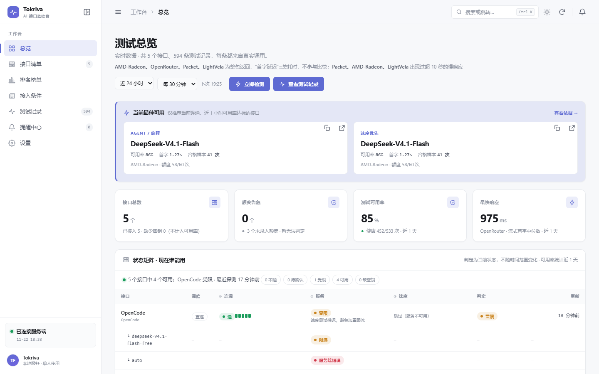
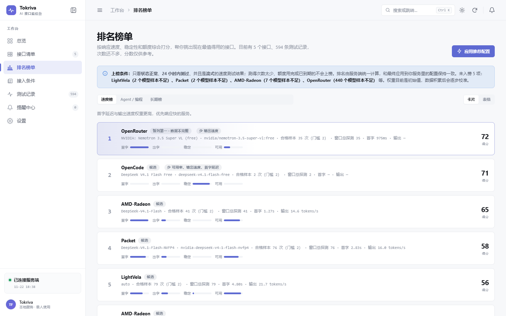
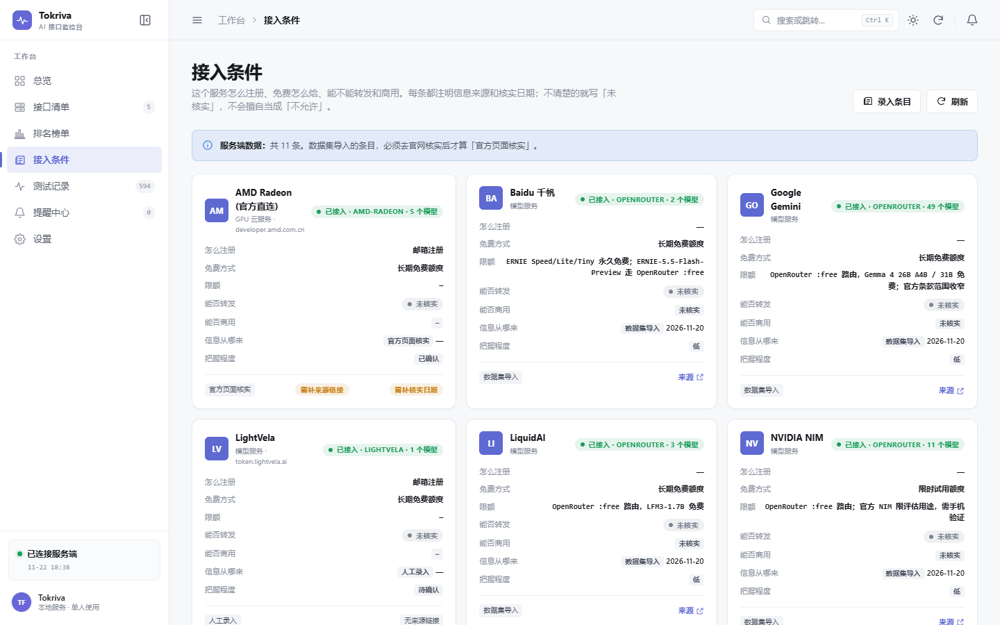
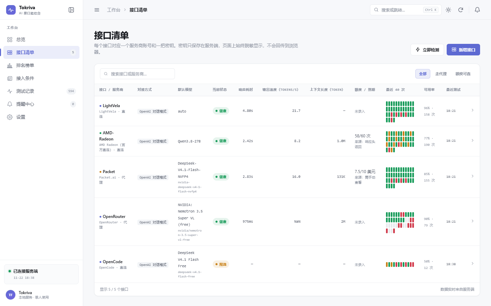

# Tokriva · 免费 AI 接口监控台

[](https://github.com/ariesfun/tokriva/actions/workflows/ci.yml)

> 实时探测各家免费 AI 算力的接口，测出真实可用率、响应速度、上下文窗口，帮你挑出「现在最值得用」的那一个。

---

## 这是什么

免费 AI 接口看起来很多，但「能注册」不等于「能用」，「能用」也不等于「好用」——有的会限流、有的响应慢、有的悄悄下线。**Tokriva 持续用真实请求去测它们**，把结果诚实地摆出来：

- 哪些接口现在**真的通**、可用率是多少
- 哪个**响应最快**（首字延迟）、哪个**出字最快**（每秒 token 数）
- 每个模型**能记多长上下文**
- 按你的使用场景（追求速度 / 写代码 Agent / 长期稳定）给出**排名推荐**

## 核心功能

| 功能 | 说明 |
|---|---|
| **测试总览** | 一眼看清：接入几个接口、测了多少次、整体可用率、最快的接口是谁 |
| **接口清单** | 每个已接入接口的当前状态、首字延迟、出字速度、上下文长度、额度怎么查 |
| **排名榜单** | 按「速度 / Agent 编程 / 长期稳定」三场景综合打分，前三名标出「当前最优」 |
| **测试记录** | 每次真实探测的原始记录，可按类型、状态筛选 |
| **接入条件** | 各家服务商的免费规则台账：怎么注册、免费怎么给、能不能转发/商用 |
| **提醒中心** | 自动盯着：额度快用完、即将到期、连续鉴权失败、接口调不通 |

## 界面预览

| 测试总览 | 排名榜单 |
|---|---|
|  |  |

| 接入条件 | 接口清单 |
|---|---|
|  |  |

## 快速开始

### 一键启动 / 关闭

双击 `scripts/start.bat` 启动、`scripts/stop.bat` 关闭；或命令行：

```bash
python scripts/start.py      # 启动（默认 8766 端口 + 30 分钟定时探测）
python scripts/stop.py       # 关闭
```

启动后浏览器打开 <http://127.0.0.1:8766/>。

### 手动启动

```bash
python -m pip install -r requirements.txt
python -m uvicorn hub.api:app --host 127.0.0.1 --port 8766
```

### 前置条件

- **Python 3.13**（项目依赖装在这个环境；本机另装的 3.11/3.8 供其他工具/项目用，勿混用）
- 各服务商的 API Key 填在根目录 `.env`（模板见 `.env.example`，Key 只存环境变量名、不回显明文）

## 设计原则

- **只测真实请求**：可用率、延迟、速度都来自真实调用，不是查文档猜的
- **诚实记账**：限流（429）不算服务故障；整包缓冲的服务测不出「出字速度」就如实标「不可测」，不编数字
- **安全门**：下发推荐配置前必须人工确认条款，服务商未核实的「能否转发」一律跳过

---

## 开发者附录

### 仓库定位

本仓库（**tokriva**，public）是项目的正式门面：项目介绍、可运行的开源实现，以及免费平台的接入清单。

### 目录

| 路径 | 内容 |
| --- | --- |
| `hub/` | 探针 + FastAPI 控制台服务 |
| `web/` | 前端展示页（零构建静态资源，由 FastAPI 同源托管） |
| `scripts/` | 一键启动/关闭脚本 |
| `docs/` | 公开文档（当前为免费平台接入适配清单） |
| `fixtures/` | 已脱敏的真实响应样本，供离线测试 |
| `data/` | 运行时数据（SQLite，不入库） |

### 技术栈

Python 3.13 · FastAPI · SQLite（单文件）· 原生 JS（零构建）。

### 安全原则

- 不把凭证、用户数据、未脱敏抓取结果提交进任何分支。
- 请求与响应头入库前，对 `authorization` / `x-api-key` / `cookie` 等敏感字段做脱敏（见 `hub/scrub.py`）。

免费平台的核实配置、接入操作与验证步骤，见 [docs/2026-11-23_免费平台接入适配清单.md](docs/2026-11-23_免费平台接入适配清单.md)。
